# План реализации

Код в этой сессии не создаётся. Каждая следующая сессия берёт одну фазу и не заходит в следующую.

Источники, по которым писать код: [db_schema.md](db_schema.md), [api_contracts.md](api_contracts.md), [use_cases.md](use_cases.md), [../task/system-design.md](../task/system-design.md). Макет [etolegko_design](https://www.figma.com/design/FoSx9BewXlyoFjRvIcJ3gJ) задаёт состав экранов, не пиксели. Противоречие со старыми инструкциями агентов (`NAME_PREFIX`, `GET /config`, pull с `discard_local`, enable только на списке) решается в пользу этих четырёх файлов и текущего макета: на карточке компании переключатель трафика, таблица имён и View details; Push, Fetch и Cancel только в редакторе потоков.

## Порядок

```mermaid
flowchart LR
    infra[Phase1_Postgres] --> api[Phase2_FastAPI]
    api --> db[Phase3_Session]
    db --> alembic[Phase4_Alembic]
    alembic --> migration[Phase5_Migration]
    migration --> auth[Phase6_JWT]
    auth --> domain[Phase7_Domain]
    domain --> web[Phase8_Next]
    web --> rtk[Phase9_RTK]
    rtk --> ui[Phase10_Components]
    ui --> pages[Phase11_Pages]
    pages --> qa[Phase12_Testing]
```

## Фаза 1. Postgres

- `docker-compose.yml`: только Postgres 16, healthcheck, volume, порт наружу.
- `.env.example` по окружению из system-design: без `NAME_PREFIX`. Существующий `.env.example` дополняется, секреты не коммитятся.
- Короткий README: как поднять базу. Backend и frontend в compose пока не добавлять, чтобы `up` не падал на отсутствующих Dockerfile.

## Фаза 2. Заглушка backend

- Каталог `backend/`: FastAPI, `GET /health` из [api_contracts.md](api_contracts.md), uvicorn.
- Dockerfile и сервис `backend` в compose, `depends_on` Postgres. Доменной логики нет.

## Фаза 3. Доступ к базе

- Async SQLAlchemy (`asyncpg`), фабрика сессии, `Depends` на сессию.
- `Base` и пустой протокол репозитория. Конкретные репозитории не писать, пока нет таблиц.
- Сервисы позже получают репозитории через конструктор, без `new` внутри роутеров.

## Фаза 4. Alembic

- `backend/alembic`, `env.py` смотрит на `Base.metadata` и `DATABASE_URL`.
- Ревизий ещё нет. Проверка: `alembic upgrade head` на пустой базе проходит.

## Фаза 5. Миграция

- Одна ревизия по [db_schema.md](db_schema.md): enum-типы, `"user"`, `geo`, `company`, `company_geo`, `idempotency_key`, `stream`, `stream_offer`, `stream_offer_snapshot`, частичные уникальные индексы.
- Имя ревизии с текущим timestamp.
- Seed: справочник `geo` и пользователь из `ADMIN_USERNAME` / `ADMIN_PASSWORD`.
- Репозитории этих таблиц: чтение и запись без бизнес-правил.

## Фаза 6. JWT

- `POST /auth/login` и проверка `Authorization: Bearer` на остальных маршрутах.
- Logout сервером не хранится: фронт забывает токен. Отдельной таблицы сессий нет.
- Пароль только как хеш. Неверный логин — `401`.

## Фаза 7. Домен

Делить на отдельные сессии. Общее: optimistic lock `version`, `SELECT … FOR UPDATE`, одна транзакция на мутацию, ошибки как в api-contracts. Keitaro ходит только `KeitaroClient`. Юнит-тесты `WeightUtil` пишутся вместе с 7.1. Полный интеграционный и e2e набор — фаза 12.

- 7.1 `WeightUtil` и юнит-тесты: хвост, pin, restore снимает pin возвращённого оффера, пустой поток, запрет `set_percent` последнего свободного.
- 7.2 `KeitaroClient`: таймауты, ретраи только на чтение и повторный Push, резолв домена, группы и источника при старте. Нет id — процесс не стартует.
- 7.3 Компании: список, карточка, создание с `Idempotency-Key`, два потока, компенсация `creating`.
- 7.4 Действия потока `offers`: add, remove, restore, pin, unpin, set_percent.
- 7.5 Push, Cancel, Fetch по контракту. Архив `removed` после Push остаётся.
- 7.6 Гео, enable/disable, stats, каталог `GET /offers`, флаг `drift` на чтении карточки.

## Фаза 8. Пустой frontend

- Каталог `fe/`: Next.js, клиентский рендер, `ChakraProvider`.
- Страниц и запросов к API нет.
- Dockerfile и сервис `frontend` в compose, `CORS_ORIGIN` указывает на него.

## Фаза 9. RTK Query

- Один API-слой RTK Query к бэкенду. JWT кладётся в `localStorage` отдельно от очереди действий.
- Очередь `company:{id}:tab:{tabId}` не входит в RTK: это локальный буфер непринятых `actions`.
- Теги кэша: companies, company, offers, stats. После мутации инвалидировать карточку.

## Фаза 10. Базовые компоненты

- Тема Chakra: холст `bg.subtle`, карточки `bg`, текст `gray.fg`, акцент `blue`, вторичный `cyan`. Свои hex и свои CSS не писать.
- `AppShell`, `Button`, `Badge`, `Input` / `Combobox`, `Table`, `Alert`, переключатель трафика, модалка создания.
- Ориентир — макет, допуск по отступам свободный.

## Фаза 11. Страницы

Экраны из макета и [use_cases.md](use_cases.md):

- login
- список компаний
- модалки создания и ошибки имени
- карточка: переключатель, имена офферов, View details, плашка без Fetch
- каталог офферов только для чтения
- редактор потоков: доли, pin, Remove, Bring back, Add, Push, Cancel, Fetch

Превью долей на клиенте заменяется ответом API. Fetch не вызывается при жёлтом потоке и непустой очереди.

## Фаза 12. Тестирование

После страниц. Продуктовый код не пишется, только тесты и отчёты о дефектах, пока явно не попросили починить.

### 12.1 Backend pytest + мок Keitaro

- Create: тот же `Idempotency-Key` и тело → та же компания; другой payload → 409; отказ Keitaro → откат; зависший `creating`.
- Actions: конфликт `expected_version` → 409; запрет `set_percent` последнего свободного; restore снимает pin; повторный `add` активного → 422.
- Push: идемпотентность; архив `removed` остаётся; отказ Keitaro оставляет `update mode` и старый снимок.
- Cancel: рабочая копия = снимок, Keitaro не вызывается.
- Fetch: при `synced` пишет снимок и не нормализует доли; при `update mode` → 409; неизвестный geo → 422.
- Enable/disable: Keitaro first; доли не меняются.
- Гонки по `version` на параллельных мутациях.

### 12.2 Frontend / e2e

- Playwright или встроенный браузер: login, create, View details, add/remove/bring back, pin, Push, Cancel, Fetch на белом потоке, переключатель трафика на карточке.
- Очередь `localStorage` переживает reload, пока API не принял действие.
- Fetch недоступен при жёлтом потоке и непустой очереди.
