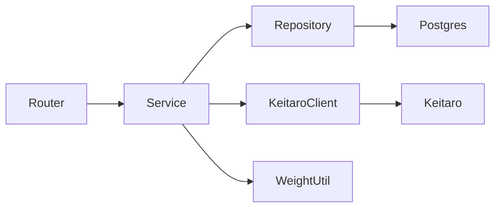
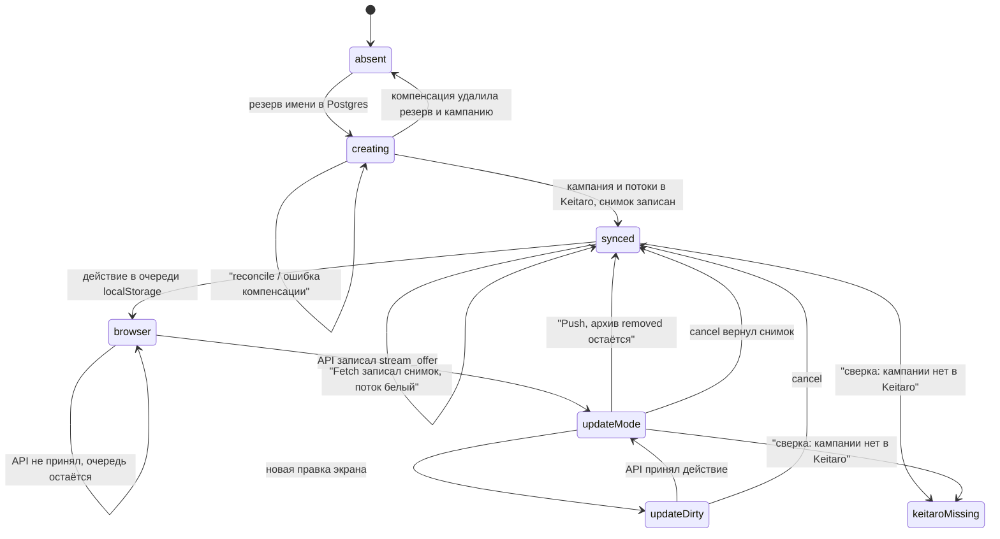
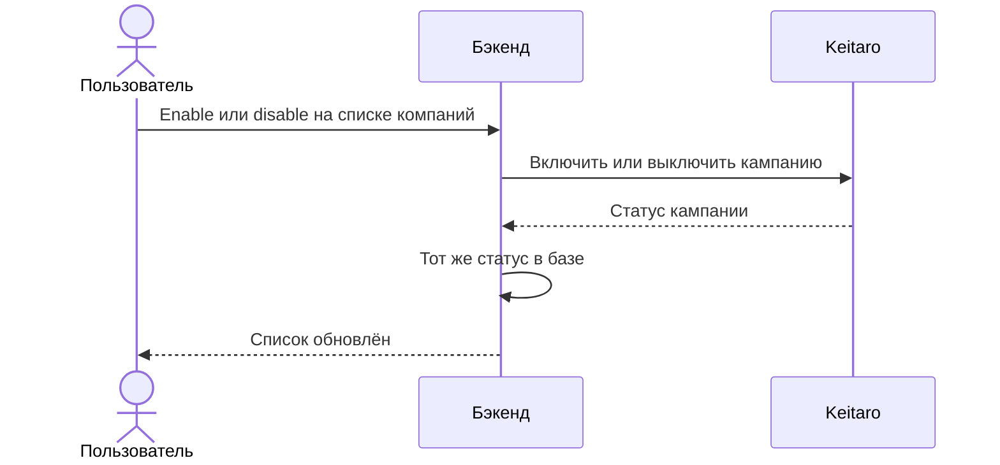

# Системный дизайн

Три хранилища. Итоговое состояние компании — их комбинация, а не одно поле статуса.

Список и редактор показывают только компании, которые есть в нашей базе. Кампания, созданная вручную в админке Keitaro, в систему не попадает. Fetch Streams обновляет потоки уже открытой компании, а не импортирует чужую.

Ролик редактора — приоритет, где он расходится с более ранней редакцией этого документа.

| Слой | Где | За что отвечает |
|---|---|---|
| Keitaro | удалённый трекер | Кампания, потоки, доли участников, клик и статистика. Источник истины для рекламы |
| DB | PostgreSQL | Обёртка компании, рабочая копия `stream_offer` и снимок `stream_offer_snapshot`, включая архив `removed` |
| localStorage | браузер | Очередь непринятых действий экрана (не копия состояния) |

Next.js не вызывает Keitaro. Ключ трекера хранится только на бэкенде.

## Стек

Бэкенд: Python, FastAPI, SQLAlchemy, PostgreSQL, Alembic. Контракт HTTP описывает OpenAPI, его отдаёт FastAPI.

Фронт: Next.js. Очередь непринятых действий лежит в `localStorage` по id компании и id вкладки/сессии. Фронт считает доли только как превью. Истину пишет бэкенд той же утилитой.

Сдача: репозиторий и README с миграциями и запуском. Дополнительно к ТЗ: docker-compose, pytest (утилита долей и sync с моком Keitaro), JWT-аутентификация.

## Структура бэкенда



Слои: `routers → services → repositories`. `KeitaroClient` (httpx, таймауты, ретраи) за интерфейсом. Зависимости передаются через конструктор (FastAPI `Depends`).

## Что лежит в каждом слое

**Keitaro.** Кампания `active` или `disabled`. Имя кампании задаётся один раз и в базе, и в трекере одинаково: это `name` из формы, без префикса. В Postgres имя уникально регистронезависимо. Редактирования имени нет.

При создании ротация потоков — по позиции. Первый поток — фильтр стран и редирект на `GOOGLE_URL`. Второй — офферы, без фильтра стран: его получают те, кого не взял первый. Дальше число потоков может вырасти за счёт `plain`, если они появились в трекере.

В Keitaro уходят только участники и их `percent`. Здесь нет `pinned`, архива `removed`, статуса синхронизации и очереди браузера.

**DB.** Компания, потоки-обёртки, офферы по id Keitaro. У потока `offers` две копии состава:

- рабочая (`stream_offer`) — то, что уже принял API
- снимок (`stream_offer_snapshot`) — последний опубликованный состав обёртки, включая архив

Обе копии хранят `percent`, `pinned`, `position`, `removed`. Смена `pinned` меняет рабочую копию и переводит поток в **update mode**. Если в Keitaro отправлять нечего (изменился только `pinned`), Push только пишет снимок.

Участник — строка с `removed = false` и `percent` от 1 до 100. Вручную выставить 0 нельзя. У строки `removed = true` в UI доля 0% и серый вид; в колонке `percent` остаётся последний процент участия, `pinned` не сбрасывается. Утилита такие строки не делит. Утилита запускается, только если после действия остаётся хотя бы один участник. В базу пишется результат бэкенда.

Архив переживает Push. После успешной публикации поток белый (**synced**): рабочая копия равна снимку, серые строки и кнопка Bring back на месте. Bring back снова делает поток жёлтым.

**localStorage.** Очередь действий, которые API ещё не принял: `add`, `remove`, `restore`, `set_percent`, `unpin`, `pin`. Рабочая копия базы сюда не копируется. Успешный ответ API стирает принятые действия из очереди. Имени оффера и stats здесь нет. Ключ: `company:{id}:tab:{tabId}`.

## Схема БД

Таблицы:

| Таблица | Назначение |
|---|---|
| `user` | Логин и хеш пароля (seed / env) |
| `geo` | Справочник `code`, `name` (seed в миграции) |
| `company` | Имя, `keitaro_campaign_id`, гео-коды, `traffic_status`, `lifecycle` (`creating` / `ready`), `version`, timestamps |
| `stream` | Поток компании: `company_id` (FK, ON DELETE CASCADE), тип (`google` / `offers` / `plain`), `keitaro_stream_id`. Один `google` и один `offers`. `plain` — ноль или больше. `keitaro_stream_id` уникален |
| `stream_offer` | Рабочая копия потока `offers`: `offer_id`, `percent`, `pinned`, `removed`, `position` |
| `stream_offer_snapshot` | Снимок той же строки: `offer_id`, `percent`, `pinned`, `removed`, `position` |

Статус **synced** / **update mode** вычисляется сравнением рабочей копии со снимком (включая `removed`) и в базе не хранится.

Потоки не существуют отдельно от компании. Редактор открывается только из карточки компании. В меню нет общего списка потоков.

Поток `google` и любой `plain` в редакторе — строка потока. Редирект, фильтры и состав офферов у них не показываются и не редактируются. Фильтр и URL потока `google` при создании в Keitaro записываются, на экран потока не выводятся. Гео компании редактируется отдельно.

Каталог offers — чтение Keitaro, не редактируемая таблица. `GET /offers` отдаёт id и имя, опционально фильтр `q`. Создавать, менять и удалять оффер из этой обёртки нельзя. В базу каталог не пишется.

## Два порядка записи

Офферы: сначала рабочая копия в базе, потом Push в Keitaro.

Гео: Keitaro first. Сначала фильтр стран на потоке `google`, после успеха — запись в базу. Если трекер не принял изменение, база остаётся прежней. Имя компании после создания не меняется. Cancel гео не откатывает.

Домен, группа и источник задаются при создании и дальше не меняются. Имена берутся из env, бэкенд резолвит id в Keitaro при старте и кэширует. Если не найдены — приложение не стартует.

## Гео

В форме список кодов, как в макете: `MX,AU,RO`. Справочник лежит в таблице `geo`: `code` и `name`. Данные заливает seed в миграции Alembic, без стороннего API. Код компании принимается только если он есть в этой таблице. Список непустой.

## Доли и pinned

После действий редактора у потока с участниками сумма `percent` всегда 100. Числа целые. У потока без участников этой суммы нет. Исключение — Fetch: доли пишутся как в Keitaro, даже если сумма не 100. Утилита включается на следующем действии редактора и доводит сумму до 100, поток после этого жёлтый. Три оффера в речи ролика звучат как 33%: целая утилита даёт 34/33/33, хвост — первому по `position`, затем по `offer_id`.

Утилита и проверки долей запускаются только если после действия остаётся хотя бы один участник. Потоки `google` и `plain` в утилиту не входят. Удаление последнего участника утилиту не запускает: поток `offers` сохраняется без участников, сумма 100 для него не считается. Строки `removed` участников не добавляют. Следующий участник получает 100.

Пока в потоке остаётся участник, утилита запускается на каждое действие с составом. Фронт считает доли только как превью. Бэкенд считает их снова и пишет свой результат.

Порядок утилиты:

- в делении не участвуют строки `removed`
- `pin` замораживает текущий `percent` (`pinned = true`), новое число не вводится
- `set_percent` ставит указанный `percent`, закрепляет оффер и оставляет ему это значение
- `unpin` возвращает оффер в общее деление
- `pinned = true` сохраняет свой `percent`
- из 100 вычитается сумма pinned среди участников
- остаток делится поровну между участниками с `pinned = false`
- хвост от деления раздаётся по 1: по возрастанию `position`, затем по `offer_id`
- новый оффер получает `position` в конец

В Keitaro уходит та же сумма участников. Строки `removed` в запрос не попадают.

### Правило «все закреплены»

Нельзя закрепить последнего незакреплённого оффера через `set_percent`, если после этого сумма `pinned` не равна 100. Для `pin` текущего процента сумма уже 100, правило не мешает. Проверка на фронте и на бэкенде (422).

Если закреплённым не остаётся места для остальных (сумма `pinned` больше 100 или остаток меньше числа незакреплённых: каждому нужен минимум 1), действие отклоняется. Фронт не отправляет такую правку, бэкенд отвечает 422.

### Архив, Remove и Bring back

`removed` — строка архива в обеих копиях, не флаг «ещё не отправили». Жёлтый поток — это отличие рабочей копии от снимка, а не сама серая строка.

Remove: `removed = true`, UI 0%, серый вид, кнопка Bring back. Остальные участники пересчитываются. Поток жёлтый, пока нет Push. В Keitaro на этом шаге ничего не уходит.

Push: в трекер уходят только участники. Строки `removed` остаются в Postgres. Снимок копирует рабочую копию вместе с архивом. Поток белый, серые строки на экране.

Bring back (`restore`): снимает `removed` и `pinned` у этой строки, затем запускает утилиту. Оффер входит в свободное деление. Чужие закреплённые участники сохраняют свой `percent`. Поток снова жёлтый. Следующий Push возвращает оффер в Keitaro.

Повторное добавление id, который уже лежит в архиве, трактуется как `restore`. Один и тот же активный оффер нельзя добавить в один поток дважды.

Cancel: очередь `localStorage` стирается, рабочая копия становится снимком. Офферы, добавленные после последнего Push, из базы исчезают. Архив, уже попавший в снимок, остаётся. В Keitaro запрос не уходит. Поток белый.

Поток без участников допустим. Сумма 100 включается снова, когда появляется хотя бы один участник.

## Окружение

```
KEITARO_URL=
KEITARO_API_KEY=
KEITARO_DOMAIN=in.posdk.xyz
KEITARO_GROUP=FORTESTS
KEITARO_SOURCE=FORTESTS
GOOGLE_URL=https://google.com
DATABASE_URL=postgresql+asyncpg://...
JWT_SECRET=
ADMIN_USERNAME=
ADMIN_PASSWORD=
CORS_ORIGIN=http://localhost:3000
```

Значения домена, группы и источника по умолчанию взяты со скриншота трекера — их нужно поправить у себя. ID домена, группы и источника резолвятся при старте приложения и кэшируются. Если не найдены — приложение падает при старте.

## Валидация

Одинаковые проверки на фронте и на бэкенде:

- гео — непустой список кодов из таблицы `geo`
- имя компании: 1–64 символа, `[a-zA-Z0-9_\- ]`, без ведущих и хвостовых пробелов; уникально регистронезависимо
- `percent` участника — целое от 1 до 100, вручную 0 выставить нельзя. После действия редактора сумма участников равна 100. Сразу после Fetch сумма может быть другой: это доли трекера, не ошибка валидации
- закреплённые доли оставляют остаток хотя бы по 1 на каждый незакреплённый оффер, иначе действие отклоняется
- `set_percent` последнего незакреплённого оффера отклонён, если сумма `pinned` после этого не равна 100
- у потока без участников проверки долей нет
- один и тот же активный оффер нельзя добавить в один поток дважды

## Состояния слоёв

Keitaro: нет кампании, `active`, `disabled`.

DB lifecycle компании: `creating` | `ready`.

DB sync для потока `offers` у компании `ready`:

- **synced** — рабочая копия равна снимку. Серый архив при этом может быть на экране
- **update mode** — рабочая копия отличается от снимка. В редакторе поток жёлтый, кнопки Push и Cancel

Отдельных статусов «трекер впереди» и «конфликт» нет. При открытии страницы бэкенд один раз читает Keitaro и сравнивает с базой. В сравнение участников входят только строки `removed = false`: их набор и `percent`. Серая строка, которой нет в трекере, расхождением не считается. Также сравниваются наличие потока `google`, список `plain`, гео, признак `active`/`disabled`, существование кампании. Любое расхождение — плашка, не поле в базе. Плашка ничего не пишет. Если Keitaro недоступен — страница открывается из базы с пометкой «сверка недоступна».

localStorage: **clean** (очередь пуста) или **dirty** (есть непринятые действия).

Включение и выключение — отдельный признак кампании, `active` или `disabled`. Его меняет только экран компаний. Потоки, `stream_offer`, снимок и `localStorage` при этом не меняются.

## Итоговые состояния

| Состояние | Keitaro | DB lifecycle | DB sync | localStorage | Что видит пользователь |
|---|---|---|---|---|---|
| Нет компании | нет | нет | — | clean | Форма создания |
| Создаётся | может быть | creating | — | clean | Список: «создаётся», редактор недоступен |
| Полный sync | есть | ready | synced | clean | Белые потоки. Серый архив допустим |
| Правка только в браузере | есть | ready | synced | dirty | Экран изменён, база ещё прежняя |
| Сохранено в обёртке | есть | ready | update mode | clean | Жёлтый поток: база изменилась, Keitaro ещё нет |
| Обёртка и браузер разошлись | есть | ready | update mode | dirty | В базе уже есть правки, на экране есть ещё не отправленные |
| Кампании нет в Keitaro | нет / удалена | ready | любое | любое | Плашка «кампания пропала в трекере», Fetch и Push недоступны |

`dirty` переживает обновление страницы, пока API не принял действия. Признак трафика `active`/`disabled` идёт рядом и число комбинаций не увеличивает.

Push публикует участников рабочей копии в поток `offers`. Гео и признак трафика в Push не входят: у них свои запросы Keitaro first. Если очередь ещё dirty, фронт сначала прогоняет действия через API, затем вызывает Push.

## Переходы



Fetch из **update mode** и при непустой очереди не меняет состояние: запрос отклонён.

## Создание

Форма принимает: `name`, непустой список гео-кодов, один `offer_id`. Оффер получает 100%. Поле `percent` в DTO создания отсутствует. Имя уходит в Keitaro как введено, после проверки. Отдельного префикса и `GET /config` нет.

Валидация имени — см. раздел «Валидация». Перед созданием бэкенд проверяет дубль этого имени в Keitaro.

Заголовок `Idempotency-Key` обязателен. Повтор с тем же ключом и тем же payload возвращает уже созданную или создающуюся компанию. Повтор с тем же ключом и другим payload — 409. Параллельный create с тем же именем блокируется уникальным индексом в Postgres.

Последовательность:

1. Резерв строки компании в Postgres со статусом `creating`, `version = 1`.
2. Кампания в Keitaro: домен, группа и источник из кэша старта, ротация потоков по позиции.
3. Поток `google`, позиция 1: фильтр «страна входит в список гео», действие — редирект на `GOOGLE_URL`, офферов нет.
4. Поток `offers`, позиция 2: фильтра стран нет, выбранный оффер на 100%.
5. Дописать `keitaro_campaign_id` и id потоков, записать снимок участника, `lifecycle = ready`. Состояние — полный sync.

Ошибка Keitaro: попытка удалить уже созданную кампанию в трекере и снять резерв. Если компенсация упала — строка остаётся в `creating`, ошибка логируется. Фоновый reconcile периодически дозавершает или чистит зависшие `creating`.

Повтор с тем же именем и другим `Idempotency-Key`: 409, в теле `lifecycle` существующей компании (`ready` или `creating`).

Форма не использует `localStorage` компании: компании ещё нет. Бэкенд прогоняет веса через утилиту (один оффер → 100).

## Контракт правки офферов

Действия принимает только поток `offers`. Клиент шлёт действие и `expected_version`, не итоговое состояние:

```json
{
  "action": "add | remove | restore | set_percent | unpin | pin",
  "offer_id": 123,
  "percent": 40,
  "expected_version": 7
}
```

`percent` обязателен только для `set_percent`. Бэкенд:

1. Проверяет `expected_version` (иначе 409).
2. Берёт `SELECT … FOR UPDATE` на компанию.
3. Применяет действие, запускает утилиту, валидирует.
4. Пишет рабочую копию, инкрементирует `version`.
5. Возвращает итоговое состояние потока и новый `version`.

Фронт считает доли только для превью до ответа. Успех — удаляет действие из очереди `localStorage`. Ошибка сети — очередь остаётся dirty, DB не меняется. Ошибка валидации — действие убирается из очереди или помечается отклонённым, фронт показывает ошибку.

Новый оффер при `add` ищется через `GET /offers`: UI ходит в наш API, API ходит в Keitaro.

## Гео

Отдельный запрос, Keitaro first: меняется фильтр стран только у потока `google`. Успех в трекере, затем обновление базы и инкремент `version`. Имени в этом запросе нет. Ошибка трекера оставляет базу прежней. Если трекер уже принял, а запись в базу упала — расхождение выявит сверка при следующем открытии. Поток `offers` этот фильтр не получает.

## Push

Кнопка Push. Идемпотентный:

1. Если очередь dirty — фронт сначала прогоняет действия через API, затем вызывает Push.
2. Бэкенд читает поток `offers` в Keitaro.
3. В трекер уходит итоговый список участников и их `percent`, если он отличается. Гео и traffic в этот запрос не входят.
4. Один PUT потока (или эквивалент API Keitaro) с этим списком.
5. В одной транзакции снимок заменяется полной рабочей копией, включая `removed` и `pinned`. Строки архива не удаляются. Инкремент `version`, если снимок изменился.

Отказ Keitaro оставляет рабочую копию и **update mode**, снимок не трогается. Повторный Push снова сравнит и при совпадении состава только допишет снимок.

Участник, которого удалили в трекере, пока у нас он ещё активен, вернётся в Keitaro этим Push. Чтобы оставить его в архиве, нужен Fetch, не Push.

Push в выключенную кампанию разрешён, если API Keitaro принимает изменение потоков у `disabled`. Отказ трекера оставляет **update mode**. Принимает ли Keitaro правку у `disabled` — проверить на стенде.

## Cancel

Стирает очередь `localStorage`. Если DB в **update mode**, рабочая копия заменяется снимком, включая `pinned` и `removed`. В Keitaro запрос не отправляется. Состояние — **synced**. Инкремент `version`.

## Fetch Streams

Кнопка ролика. Читает потоки нашей кампании в Keitaro. Push не вызывает.

Уже решено по ролику:

- участник, которого в ответе трекера нет, становится `removed`: в UI серый, доля 0%, кнопка Bring back; строка из Postgres не удаляется
- оффер, который есть в трекере и которого нет у нас, добавляется участником с `pinned = false`
- поток без офферов, который не является нашим `google`, сохраняется как `plain`: на экране только строка потока
- поток `google` узнаётся по `keitaro_stream_id`, его URL и фильтр на экран не выводятся
- `plain`, которого в трекере больше нет, из базы удаляется: архива у такого потока нет

Запись, если поток **synced** и очередь пуста. Один запрос, одна транзакция, затем поток снова белый:

- пропавший участник становится `removed`; `percent` и `pinned` строки не используются, пока она в архиве
- оффер, которого у нас не было, добавляется участником: `percent` из Keitaro, `pinned = false`
- серый оффер, который снова есть в трекере, снова участник: `percent` из Keitaro, `pinned = false`
- у общего оффера `percent` берётся из Keitaro; `pinned` сохраняется только если процент не изменился, иначе `pinned = false`
- сумма не пересчитывается. Если она не 100, так и хранится в рабочей копии и в снимке
- гео компании берётся из фильтра потока `google`, признак трафика — из статуса кампании
- код гео, которого нет в справочнике `geo`, отклоняет весь Fetch: 422, база не меняется
- снимок заменяется рабочей копией, включая архив. Инкремент `version`

Жёлтый поток или непустая очередь: фронт не шлёт Fetch. Бэкенд отвечает 409, если рабочая копия не равна снимку, и ничего не пишет. Сначала Push или Cancel.

Сверка при открытии страницы только показывает плашку. Сама она Fetch не вызывает. На плашке кнопка Fetch активна только при белом потоке и пустой очереди.

## Enable и disable

Кнопки на экране компаний. Не входят во флоу правки потоков. Не открывают редактор, не читают `localStorage` и не меняют доли.



Сначала Keitaro, затем база. Ошибка трекера оставляет прежний статус в базе. Если трекер переключился, а запись в базу упала — расхождение выявит сверка при открытии. Несохранённые правки потоков остаются как были.

## Конкурентность

- `company.version` — optimistic lock на все мутации компании и потоков.
- `SELECT … FOR UPDATE` на строку компании внутри сервисов записи.
- Очередь `localStorage` ключуется по id компании и id вкладки/сессии, чтобы вкладки не затирали чужие очереди.

## Ошибки Keitaro

- Таймауты на все вызовы.
- Ретраи только для идемпотентных чтений и повторного Push.
- Ошибки трекера маппятся в 502 / 504.
- При недоступности Keitaro на открытии страницы потоков: данные из базы + флаг `reconcile_unavailable`.

## Имена офферов и статистика

Каталог офферов читается из Keitaro. Кэш с TTL и батч-запрос по id для карточки потока. Поиск офферов — через API Keitaro. Если серверного фильтра нет — фильтрация на бэкенде по загруженной странице или кэшу.

`GET /companies/{id}/stats` — clicks, uniques, bots из Keitaro. Пустые значения допустимы, на сохранение и Push не влияют. В DB и `localStorage` stats не пишутся.

## Границы данных

В Keitaro уходят имя, гео (фильтр потока `google`) и `percent` участников. Домен, группа и источник задаются при создании. `pinned`, `removed` и статус синхронизации в Keitaro не уходят.

Из Keitaro читаются каталог офферов, имя, stats и, при сверке или Fetch, кампания с потоками.

Поток `google` офферов не имеет. У потока `offers` можно убрать всех участников: поток без участников допустим, утилита долей его не проверяет. Поток `plain` не редактируется.

## API

Все эндпоинты за JWT, кроме `POST /auth/login` и `GET /health`. CORS только на `CORS_ORIGIN`.

OpenAPI покрывает:

- `POST /auth/login` — логин/пароль → JWT
- `POST /companies` — создать компанию (`name`, `geo_codes[]`, `offer_id`), заголовок `Idempotency-Key`; идемпотентно
- `GET /companies` — список из своей базы, пагинация и поиск по имени
- `GET /companies/{id}` — карточка: lifecycle, sync-статус (вычисляемый), `version`, рабочая копия вместе с архивом, гео, traffic
- `GET /companies/{id}/stats` — clicks, uniques, bots
- `GET /offers` — каталог Keitaro, только чтение, поиск `q`
- `POST /companies/{id}/streams/{stream_id}/actions` — действие над `stream_offer` потока `offers` и `expected_version`
- `PATCH /companies/{id}/geo` — гео через Keitaro first, без смены имени
- `POST /companies/{id}/sync` — Push участников
- `POST /companies/{id}/fetch` — Fetch Streams. При **synced** и пустой очереди пишет снимок, гео и traffic, поток остаётся белым. Иначе 409
- `POST /companies/{id}/cancel` — откат рабочей копии к снимку
- `POST /companies/{id}/enable` и `POST /companies/{id}/disable` — со списка компаний

Карточка отдаёт состояние DB и состав рабочей копии, включая `removed`. Состояние `localStorage` в API не передаётся: его знает только браузер.

## Аутентификация

Простая: один или несколько пользователей из seed / env. JWT в `Authorization: Bearer`. Все мутации и чтение компаний требуют валидный токен.

## Инфраструктура и тесты

- `docker-compose`: Postgres + backend + frontend.
- pytest: `WeightUtil` (хвост, pinned, restore снимает pin у возвращённого оффера, пустой поток, запрет `set_percent` последнего незакреплённого); Push оставляет архив `removed`; cancel возвращает снимок и не зовёт Keitaro; Fetch при **synced** пишет снимок и не нормализует доли, при **update mode** отвечает 409.
- README: миграции Alembic, env, запуск через docker-compose и локально.

## Открытые вопросы

- Принимает ли API Keitaro правку потоков у кампании в `disabled` — проверить на стенде.
